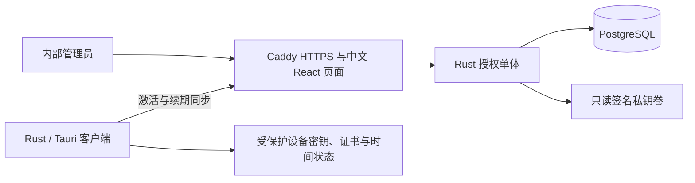

# Rust 精简授权服务方案

目标是自托管的多应用、单设备、长期离线授权系统。采用 Rust 单体后端，复用现有中文 React 管理界面和 Rust 离线校验器，只保留自有软件授权所需的能力。

当前运行后端为 Rust，已实现 Web 管理、单设备激活、续期同步与确认、离线 SDK 及 Docker 部署。GlueSight 的系统保护存储和业务入口接入仍需在其自身仓库完成。操作说明见[离线授权使用说明](../features/offline-device-activation.md)和[Docker 部署](../deployment/docker.md)。

## 1. 不变的业务规则

- 一个后台管理多个应用，共享内部管理员，不做多租户 SaaS。
- 每份授权绑定一台设备，同时验证设备私钥持有和当前硬件指纹。
- 首次激活联网，之后至合同到期均可离线运行，无心跳、周期联网或短期租约。
- `now >= exp` 停用，无宽限期；提前 `7 × 86400` 秒提醒。
- 中文页面使用北京时间，数据库和签名使用 UTC 秒。停用日期 2026-12-01 表示当天北京时间 00:00 停用；若约定 12 月底前可用，应选择 2027-01-01。
- 管理员确认续约后延长合同并重签，客户联网同步一次后继续离线使用；未领取新证书仍按旧证书到期。
- 到期后禁止新检测任务，当前工件允许安全结束，查询、导出和授权同步入口保留。实际门禁在 GlueSight 的 Rust 业务入口实现。

长期离线不能即时撤销已下载证书，也不能保证抵御管理员修改客户端、克隆整机或回滚虚拟机快照。后台撤销表示禁止后续激活/同步，不表示客户离线软件已停止。

## 2. 功能取舍

| 保留并精简 | 目标范围 |
| --- | --- |
| 应用管理 | 不可变 UUID、唯一标识、名称、说明、签名公钥；有授权的应用只归档、不删除 |
| 授权管理 | 客户名称/邮箱、停用时间、权益快照、激活秘密、设备绑定、证书修订 |
| 激活 | 设备挑战签名、单设备事务绑定、幂等重试、签名时间回执 |
| 续期 | 绝对新期限、修订检查、重签、设备主动领取及确认 |
| 管理认证 | 内部管理员、密码哈希、服务端会话、CSRF、登录限流；先不做角色体系 |
| 密钥与审计 | 产品独立密钥；记录创建、激活、续期、撤销和密钥切换 |
| 运维 | Docker、健康检查、结构化日志、迁移、备份与恢复 |

| 不迁入 Rust 后端 | 处理方式 |
| --- | --- |
| Policy 通用策略引擎 | 无策略页；创建授权直接填写期限与权益，初期权益默认空对象 |
| 多席位、浮动授权、租约、心跳和席位回收 | 单设备是固定规则，不提供开关 |
| v1 签发、在线 validate、自由解绑和演示页面 | 新服务仅支持 v2；真实 v1 存量按迁移规则单独处理 |
| 支付、订阅、Stripe/Webhook、外部自动签发 | 内部管理员确认续约，无支付系统联动 |
| 通用 API key 平台、Java starter/CLI、Go/Swift SDK | 不进入目标服务部署和新发布矩阵；设备通过自己的私钥认证 |
| 复杂生命周期框架、到期扫描、在线校验缓存 | 显式保存撤销，是否过期按期限计算；客户端决定离线运行权 |
| 微服务、Redis、消息队列、动态插件 | 首期均不引入 |

暂停/恢复、复杂套餐升级不进入首期。换机审批和异常时间恢复作为独立后续能力；首期遇私钥或保护状态丢失时拒绝离线解锁，不能靠旧激活秘密自动重绑。

精简减少业务面，但保留认证、幂等、并发锁、密钥保护和审计。Java 模块保留供迁移和协议向量核对，不进入当前部署与发布链；不自动删除旧数据库。

## 3. 技术与部署

使用 Rust + Axum/Tokio 提供 HTTP 服务，SQLx 访问 PostgreSQL，Ed25519 签名。依赖在实施时选择兼容版本并提交 Cargo.lock，不在方案中指定浮动最新版。Axum 支持 Tower 中间件，SQLx 提供 PostgreSQL 驱动、连接池和迁移工具，见[Axum 官方文档](https://docs.rs/axum/latest/axum/)和[SQLx 官方仓库](https://github.com/transact-rs/sqlx)。

保留 PostgreSQL，复用行锁和唯一约束，避免同时切换语言与数据库。首期只支持一种数据库，不同时维护 SQLite 适配。



Compose 保持三个服务：gateway（静态页面与 TLS）、license-server、postgres。后端多阶段构建为一个 Rust 可执行文件，非 root 运行，不携带 JRE/Maven。生产只开放 HTTPS，管理路由限内部网段或 VPN，数据库和健康检查仅内部可达；Vite 只用于开发。

每应用独立 Ed25519 私钥及不可变 key ID。私钥通过 Docker secret 或受限数据卷只读挂载，不进入数据库、镜像、前端或客户端。启动检查权限及公私钥一致性，缺失时拒绝签发，不自动生成替代密钥。页面只显示公钥/指纹和签发 key ID，不上传或导出私钥。

部署显式运行迁移，失败不切换服务。备份数据库、密钥和 key ID 映射；恢复须检查合同修订与证书是否倒退。服务端停机不影响已激活客户端在期限内使用。

## 4. Rust 模块边界

目标为一个服务端 crate、一个协议 crate 和现有 verifier，不拆多个服务：

```text
server/                   HTTP、会话、授权事务、SQLx、部署入口
crates/license-protocol/   v2 字段、编码约束、挑战域、错误码、公开测试向量
verifiers/rust/            无网络校验、设备证明、到期及时间状态
dashboard/                中文 React 管理端
```

服务端内部按 admin、applications、licenses、activation、renewal、signing、storage 分模块。协议 crate 不含私钥、数据库或 HTTP 依赖，客户端不得依赖 server crate。设备私钥签名与服务端证书签名采用不同类型和用途。

复用现有 Rust 校验器和 Java/Rust 公共 fixture，重写后端不改变已签发 v2 证书的解释。保持仓库现有许可证声明与来源记录，不因换语言自行修改代码许可。

## 5. 最小数据模型

| 数据 | 关键字段/约束 |
| --- | --- |
| applications | UUID、唯一 slug、名称、说明、归档时间、当前签发 key ID |
| signing_keys | application_id、不可变 key ID、公钥、私钥文件引用、签发状态；不存私钥 |
| licenses | application_id、UUID、展示编号、客户快照、expires_at、entitlements、activation_secret_hash、revision、revoked_at |
| device_bindings | license_id 唯一、公钥、fingerprint_hash/version、binding_version、绑定时间；首期不替换绑定 |
| certificates | license_id、revision、binding_version、serial、key ID、完整 token、签发原因；版本组合唯一 |
| challenges | operation、nonce、产品/授权/设备上下文、expires_at、消费信息和幂等响应 |
| renewals | 幂等键/请求摘要、旧新期限及修订、操作者、原因、serial、设备确认时间 |
| admin_users / admin_sessions | Argon2id 密码哈希、管理员状态、会话 token 摘要、会话期限 |
| audit_events | 操作者、应用/授权 ID、动作、非敏感变更摘要、时间 |

是否激活由绑定表达，到期根据当前时间计算，撤销单独存储；页面优先显示撤销、其次到期，再显示是否激活。无需后台不断写入 EXPIRED 状态。创建固定有限期限、单设备、零宽限。

权益直接保存为授权快照，初期仅支持布尔、字符串及安全范围整数，无需求时 `ent={}`；修改应用默认配置不改变已签合同。无需先创建策略。

激活秘密使用 CSPRNG 生成 256 bit，只在创建时展示，保存摘要且不写日志。绑定后不允许凭秘密换设备。尚未激活的秘密遗失补发需要独立契约，首期不自动处理。

所有授权写操作固定先锁 licenses，再锁挑战和关联记录，数据库唯一约束兜底单设备及证书版本。幂等记录与业务同事务，重复键不同请求摘要返回 409，签名或提交失败不返回证书。

## 6. 协议与 API

保留当前三段 Ed25519 封装：Header `alg=EdDSA`、`crv=Ed25519`、`typ=GMT`，Header kid 为签名 key ID。Payload 保留 `ver=2`、`mode=offline_device`、`lid`、展示编号 `kid`、`product_id`、`prd`、`serial`、`revision`、`binding_version`、`device_key_hash`、`fingerprint_hash/version`、`iat/nbf/exp`、`ent`、`seat=1`。

设备摘要为原始 32 字节公钥的 SHA-256，base64url 无填充；公钥为标准 Base64。按收到的原始签名字节验签，拒绝重复 JSON key、浮点/不安全整数、未知算法/版本及缺失期限。客户端产品 UUID 和可信公钥来自应用配置，不能从待验响应建立信任。

首次激活保留当前已实现的设备路径、字段及挑战原文。管理 API 与前端同时升级：

| API | 用途 |
| --- | --- |
| `/admin/auth/login`、`/admin/auth/logout`、`/admin/auth/me` | HttpOnly/Secure/SameSite Cookie 会话；写操作验证 CSRF，退出使会话失效 |
| `/admin/v2/applications` 及 `/{id}` | 应用创建、查询、编辑和归档；公钥另设只读端点 |
| `POST /admin/v2/licenses` | applicationId、customer、expiresAt、entitlements；不再要求 policyId，返回待激活记录及秘密 |
| `GET /admin/v2/licenses` 及 `/{id}` | 分应用筛选及详情，UUID 定位，不返回秘密摘要 |
| `POST /admin/v2/licenses/{id}/revoke` | 审计化撤销，不声称即时停止离线设备 |
| `POST /v2/licenses/challenges`、`/v2/licenses/activate` | 保留[当前首次激活契约](../features/offline-device-activation.md#激活-api) |
| `POST /admin/v2/licenses/{id}/renewals` | expectedRevision、绝对 newExpiresAt、幂等键、原因 |
| `POST /v2/licenses/sync-challenges`、`/v2/licenses/sync` | 前者申请 sync 或 ack 用途挑战（ack 绑定目标 serial）；后者用 sync 挑战证明原设备，领取当前证书和时间回执，不延长合同、不新增 revision |
| `POST /v2/licenses/acknowledgements` | 独立 ack 挑战、设备签名、serial；确认本地已验证并保存，不复用已消费的 sync 挑战 |

管理端 applicationId 与设备端 productId/product_id 均映射同一个不可变应用 UUID，迁移不按名称重新生成。管理创建请求是显式破坏性更新，切换时同批部署对应前端，不能混用当前 policyId 表单。

首次激活维持 `grantmint.activate.v2` 原文。新增同步和确认使用独立操作域，签名覆盖 operation、nonce、应用、授权、设备及目标 serial，挑战不能跨用途使用。挑战五分钟、单次消费，请求尺寸、限流及幂等缓存均设固定上限。无效凭据与不存在/错应用统一返回 `invalid_activation_credentials`，不泄露存在性。

`GMT-TIME` 回执绑定 nonce、operation、应用/授权、设备摘要、serial 和服务端时间。新增同步回执需同步扩展 verifier 操作白名单，不得调用仅接受首次激活的 `accept_activation` 重置已有状态。

## 7. 激活、离线与续期流程

首次激活：设备生成密钥、采集指纹 → 请求挑战 → 核对上下文后签名 → 服务端锁授权并检查凭据、设备与期限 → 同事务绑定、签证书、消费挑战和写审计 → 客户端验证并原子保存证书及时间状态。并发两设备只允许一个成功，同设备丢响应可重试且不增加 revision。

长期离线：verifier 检查签名、产品、实际设备密钥持有、当前硬件指纹、期限和保护状态，无网络请求。业务必须判断 `allows_new_work()`，验签成功不等于尚未到期；启动、唤醒、每次接件及运行期间重新检查。提醒和禁用不依赖服务端任务。

续期：管理员提交绝对新期限 → 锁授权，核对 expectedRevision、未撤销、新期限严格大于旧期限及当前时间 → 记录续期、revision 加一 → 已绑定则给同设备重签，未绑定只更新合同 → 提交。重复请求不累加天数，签名失败不留下新合同。到期但未撤销的授权允许续期。

同步：原设备完成独立挑战证明 → 服务端返回当前证书和时间回执 → 客户端核对产品、设备、有效期限及不降低的 revision/binding_version → 原子替换并保存高水位 → 确认 serial。未收到确认时后台显示“已续约，设备尚未确认”，HTTP 响应发出不等于客户端生效。

过期客户端保留同步入口；失败保留原证书，未领取仍按旧 exp 停用。撤销阻止后续激活/同步，不能立即禁用已有离线副本。

## 8. 中文界面与客户端

管理页收敛为应用、授权列表/详情、创建、续期和审计。移除策略页、v1 模式和演示、心跳、浮动席位及强制解绑。创建只填客户、停用日期、可选权益，显示完整北京时间和提前七天提醒日。

Tauri command 返回 UNACTIVATED、VALID、EXPIRING、EXPIRED、CLOCK_SUSPECT、INVALID 等状态，不返回私钥。提醒由客户端计算；关闭期间不承诺弹窗，再启动立即显示。GlueSight 工件门禁在其自身仓库交付，本授权服务不修改 PLC 协议。

Windows 使用 DPAPI 与 ACL，Linux 使用系统凭据存储或受限文件适配；这些生产适配仍需实现。指纹使用版本化稳定设备标识，拒绝空/占位值，不用 MAC/IP/主机名；原始标识不上传。当前库只接收摘要，不能把证书中的摘要当成本机硬件采集结果。

保护状态保存 serial、最高 revision/binding_version 和 max_seen_time；进程内累计单调时间并保留亚秒余量。有效时间取墙钟与可信下界较大者，五分钟回拨容差不延长 exp。丢失/损坏状态不允许离线重新初始化。正常运行不要求定期联网；后续时间恢复必须证明当前设备并验证新挑战回执，不能信任 HTTP Date 或旧回执重放。

## 9. 迁移与切换

新服务使用独立数据库和独立迁移版本，不在同一 schema 混用 SQLx/Flyway，也不允许两套服务同时写同一授权。

1. 盘点现有产品、v1/v2 授权、key ID 和在用客户端。没有真实业务数据时使用全新环境，只导入明确选择的应用和公钥配置，不默认迁移测试记录。
2. 有真实 v2 数据时离线导出/导入，保留应用/授权 UUID、展示编号、期限、权益、设备公钥/指纹、revision/binding_version、serial、key ID 和 token 原字节；Policy 展平为授权快照。完整保留撤销状态、时间、原因及相关审计，不能重新赋予激活/同步资格。遇到 SUSPENDED 等新模型无法无损表示的状态时阻止该批切换，须明确处置后再导入，不默认映射为有效。私钥独立安全迁移并核对公钥。
3. 保持激活秘密摘要算法可验证；重新配置管理员并使旧会话失效。切换前冻结写入，等待五分钟挑战耗尽，并等待或迁移仍在保留期内的幂等记录，不丢弃承诺可重试的响应。
4. v1 不自动转 v2。有真实 v1 用户时保留隔离旧服务承接存量，另行安排重新激活；永久 v1 不会因迁移变成自动到期，不能提前关闭仍有客户端依赖的入口。
5. 临时环境验证旧 v2 离线校验、新激活及续期，再同批切换前端和网关。切换后有新修订时不能直接回滚旧数据库，须冻结写入并核对/迁回增量，否则保持故障关闭签发。
6. Rust 验收后再移除生产 Compose 的 Java 服务和无关模块构建。删除脚本前检查 CI、文档及手动运维用途；源码清理单独提交，不因文档计划删除授权数据。

密钥轮换先让客户端信任新公钥，再切换签发；旧公钥保留至对应证书到期。迁移不因换语言重新签发全部证书。

## 10. 实施顺序与验收

| 阶段 | 交付 |
| --- | --- |
| R1：替换运行基础 | Rust 服务、管理员会话、应用/授权管理、中文页面精简、SQLx 迁移、Docker 健康检查 |
| R2：激活协议对齐 | 当前 v2 互操作、单设备事务绑定、幂等、密钥保护、Java→Rust 迁移演练；通过后切换新授权服务 |
| R3：续期闭环 | 重签、设备同步及确认、verifier 接受续期证书、中文交付状态 |
| R4：客户端生产接入 | GlueSight 指纹、保护存储、工件门禁、提醒和到期禁用；异常时间恢复另做明确契约 |

R1 不单独算可交付的离线授权系统；客户上线需要 R1–R4 对应业务闭环验收。换机审批、复杂权益变更和可信硬件不纳入首期。

最小验证按业务风险选择：

- API/认证：未登录/无 CSRF 不可修改，跨产品凭据拒绝，已移除的 v1/心跳/自由解绑路由不存在。
- PostgreSQL：并发仅一设备成功；签名/提交失败回滚；重复激活同响应；并发续期无丢更新，撤销不被复活。
- 协议：公共 fixture 在新服务和 verifier 中一致，旧 token 原字节有效；拒绝篡改、未知 key、版本/算法降级及歧义 JSON。
- 离线：停服务后可正常使用，替换设备/指纹失败；注入时钟检验提醒/到期边界、回拨和高水位回退，不改生产系统时间。
- 续期：未领取按旧期限，过期仍能同步，重复同步不重签，原子替换失败保留原证书，接受新版本后拒绝旧版。
- 运维：重建保留数据/密钥，恢复不丢修订，迁移前后 UUID、绑定、serial、key ID 和证书摘要一致。

当前 CI 为 Rust fmt/clippy、业务测试、真实 PostgreSQL 集成、前端检查和 Docker 启动验收，发布链构建 Rust 二进制与前后端镜像，不再构建 Maven/GraalVM。R1–R3 已实现，R4 的应用生产集成尚未交付；不能把 SDK/CLI 的验证等同于完整现场客户端验收。
