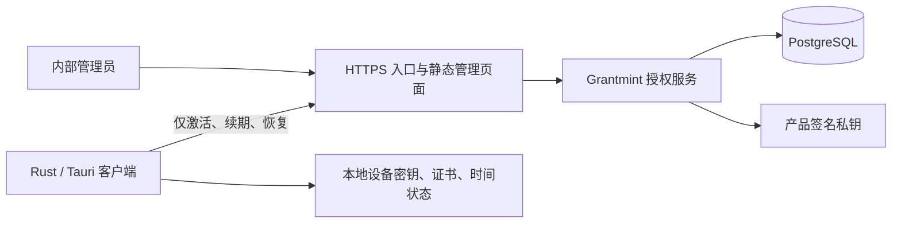

# 多应用单设备离线授权改造方案

本方案描述目标架构。当前已交付中文管理控制台、Docker 部署、v2 单设备激活和 Rust 离线验证；当前接口与边界见[使用说明](../features/offline-device-activation.md)。续期重签、设备恢复和业务应用集成尚未交付；下文中的完整数据模型和相关接口是后续设计，不代表已全部实现。

## 1. 业务规则和边界

一套自托管管理后台管理多个应用，每份授权只允许一台设备。客户首次激活需要联网；激活成功后，直到合同到期都能离线运行，不要求心跳、周期联网或短期租约。续期、设备恢复和可信时间恢复需要联网。

- 每份授权有明确的停用时刻 `expires_at`，到期边界采用 `now >= expires_at`。不提供隐式宽限期。
- 管理页面使用北京时间 `Asia/Shanghai`，数据库和签名时间统一使用 UTC Unix 秒。
- 表单写“停用日期”，并显示完整时刻。例如选择 2026-12-01，代表北京时间 2026-12-01 00:00:00 停用，最后有效时刻在此前。若合同约定“12 月底前可用”，应选择 2027-01-01，不能只填写月份。
- 提醒窗口为 `[expires_at - 7 × 86400, expires_at)`。例如上述 12 月 1 日停用，应从北京时间 11 月 24 日零点开始提醒。
- 到期、时钟异常或授权失效后，不接收新检测任务；已开始的当前工件允许完成。查询、导出、查看授权和联网续期入口始终可用。
- 本方案的第一期只服务自有多个产品，共享内部管理员；不做面向不同公司的多租户 SaaS，也不集成收费或自动扣款。

长期离线意味着服务端不能立即撤销旧证书、远程停止离线设备或确认客户是否已经停用。设备指纹和本地密钥可提高复制成本，但无法保证抵御系统管理员修改客户端、克隆整机或回滚虚拟机快照。产品说明和后台操作提示必须保持这一边界。

## 2. 当前基础与改造位置

以下对照以 v1 基础实现为起点说明目标改造范围；实际交付状态见使用说明。

| 范围 | 当前实现 | 改造 |
| --- | --- | --- |
| 多产品 | Product、Policy、产品级签名密钥和 API key 已存在；签发校验 policy 所属产品 | 复用；新接口、查询和证书严格绑定不可变产品 ID |
| 签发 | `IssuanceService` 在设备激活前生成 v1 token，状态直接为 ACTIVE | 新模式先建授权记录，激活后才签发可运行的设备证书 |
| 设备 | `ActivationService` 用授权行锁、fingerprint 唯一约束和 maxSeats 控制在线席位 | 新模式固化单设备绑定、设备公钥及指纹策略，写入签名证书 |
| 离线 | `TokenPayload` v1 无设备绑定，`LicenseVerifier` 负责基础验签 | 新增 v2 设备证书和独立 Rust 校验库 |
| 心跳 | `HeartbeatReaperJob` 按 policy 心跳间隔三倍回收设备 | 查询和写入前均排除长期离线授权；不能用极大间隔模拟 |
| 续期 | 管理 API 有签发、暂停、恢复、撤销等，尚无续期重签接口 | 追加续期记录、证书版本和设备领取协议 |
| 宽限期 | 签名 exp 为数据库到期日加 policy gracePeriodDays | 新模式强制 gracePeriodDays=0，exp 等于合同停用时刻 |
| 前端 | dashboard 有产品、策略、授权页面 | 增加产品上下文、设备、续期与交付状态 |

主要实现入口：`grantmint-server/.../issuance/IssuanceService.java`、`activation/ActivationService.java`、`activation/HeartbeatReaperJob.java`、`api/LicenseAdminController.java`、`signing/SigningKeyService.java`；token 格式在 `grantmint-core/.../token/`；后台位于 `dashboard/src/pages/`。

## 3. 部署架构

保留 Java 21 / Spring Boot / PostgreSQL 服务端，扩展现有 React 管理端；Rust 用于客户应用的公共授权库，不重写服务端。

Docker Compose 包含 HTTPS 网关、dashboard 静态资源、grantmint-server 和 postgres。生产只发布 HTTPS 端口，数据库不对外开放，管理与 actuator 入口限内部网络。Vite 开发服务器仅用于本机测试，不作为生产容器。

每个产品使用独立 Ed25519 签名密钥。私钥不进入镜像、前端包、源码或客户端；用 Linux 数据卷或 secret 文件提供，文件属主为服务用户、权限 0600，服务只读挂载。Windows bind mount 的权限映射不满足现有私钥检查，部署时使用 Docker 数据卷。生产密钥由部署步骤导入，不能依赖演示脚本在线生成。

数据库、证书记录、密钥、密钥版本及审计一起备份；恢复演练必须验证旧证书仍能验签、续期可继续、版本不倒退。应用启动失败时不自动生成替代私钥。数据库不可用不影响已激活客户端在有效期内离线使用。

## 4. 数据模型

在保留现有 v1 业务的基础上增加 `license_mode=offline_device_v2`，模式和授权快照在创建后不可原地切换。

| 数据 | 新增或约束 |
| --- | --- |
| Product | 不可变 UUID 为安全边界；slug 作为显示/兼容标识；产品可信签名公钥集合 |
| Policy | 新模式固定 maxSeats=1、gracePeriodDays=0、heartbeatRequired=false；提醒固定提前 7 天 |
| License | mode、授权修订号 revision、expires_at、权利快照、激活码摘要；新模式不返回未绑定运行 token |
| DeviceBinding | license_id、device_public_key、fingerprint_hash、fingerprint_version、binding_version、状态和时间 |
| LicenseCertificate | license_id、revision、binding_version、serial、签名 key ID、完整签名 token、有效期、签发原因 |
| Renewal | 请求幂等键、请求摘要、旧/新到期时间、旧/新 revision、操作人、原因及交付状态 |
| ActivationChallenge | 随机 nonce、用途、产品/授权/设备上下文、短期过期时间、消费状态 |

License 的“合同有效/暂停/撤销”和 DeviceBinding 的“是否已绑定”分别表达，不能因为首次激活就延长合同期限。EXPIRED 授权允许经专用续期事务恢复；REVOKED 不允许通过续期复活，SUSPENDED 必须先走显式恢复流程。

数据库为每份授权建立“最多一个有效绑定”的部分唯一索引；`(license_id, revision, binding_version)` 证书唯一；`(product_id, operation, idempotency_key)` 请求唯一。幂等键复用且请求内容不同返回 409。序号和 revision 使用受控整数范围，防止跨 Java/Rust/TypeScript 精度差异。

许可证标识可以展示给客户，但不能作为首次绑定的唯一凭据。新模式生成至少 128 bit 随机激活秘密，只展示/交付一次，服务端只保存安全摘要，绑定后禁止用它换设备。设备重装丢失密钥须管理员恢复，不能凭旧激活码自动重绑。

现有 License 的 signedToken/signingKeyId 为非空。迁移时对新模式允许为空，并把运行证书迁入 LicenseCertificate；legacy 仍必须保有原字段。同步调整 ValidationSnapshotLoader、激活前置检查和管理响应，不能生成未绑定 v1 token 作为占位，或因尚无运行证书而阻止首次激活。

## 5. v2 设备证书协议

保留现有三段签名封装与 Ed25519 算法，定义独立 `ver=2` 解析和校验路径。不要仅把设备字段塞入 v1 的可选 constraints，避免旧客户端忽略绑定仍接受证书。

| 签名字段 | 规则 |
| --- | --- |
| Header `alg/crv/typ/kid` | 固定 EdDSA/Ed25519/GMT；kid 为签名密钥 ID，来自产品可信公钥集合 |
| `ver`, `mode` | 2、offline_device；不支持版本必须拒绝 |
| `lid`, `kid`, `product_id`, `prd` | 授权 UUID、展示授权编号、不可变产品 UUID、兼容 slug；注意 payload kid 不是签名 key ID |
| `serial`, `revision`, `binding_version` | 证书 ID、合同修订号和设备绑定版本，参与验签和本地防回退 |
| `device_key_hash` | SHA-256(原始设备 Ed25519 公钥)，32 字节摘要的 base64url 无填充编码 |
| `fingerprint_hash`, `fingerprint_version` | 按版本化设备指纹算法生成，客户端必须重算匹配 |
| `iat`, `nbf`, `exp` | 必填 UTC 整数秒；exp 不可为空且大于 nbf；签发续期证书立即生效，到期仍不变更既有语义 |
| `ent`, `seat` | 明确的权利快照；seat 固定 1 |

签名验证使用收到的原始两段字节，不把 JSON 重序列化后验签。沿用现有编码规则，额外明确拒绝重复 JSON key、非法整数、重复/不支持算法和缺失必填字段；发布 Java/Rust 共用的正常与异常测试向量。

Rust 应用内置产品 UUID 和产品公钥集合，不能从证书自身或未认证 API 任意信任公钥。密钥轮换先发布同时信任新旧公钥的客户端，再切换签发；旧公钥保留到其证书全部到期。无法升级的客户端继续使用受控兼容签名策略，服务端不得静默改签为它不认识的密钥。公钥集合升级可由内置根公钥签名，但属于后续独立协议。

## 6. 激活与长期离线

1. 客户端生成设备密钥对，在本机保护私钥；采集版本化指纹。Windows 默认使用 DPAPI 保护并限制文件 ACL，Linux 使用系统凭据存储或限制为本机用户的 0600 文件。两者都不是不可导出的硬件密钥保证。
2. 指纹 v1 使用产品域分隔、平台和稳定设备标识的规范编码后 SHA-256；Windows 使用 MachineGuid 和有效 SMBIOS UUID，Linux 使用 machine-id 和可用 DMI UUID。拒绝空值/占位值；按平台记录组件是否存在，固定大小写及字节编码，不使用 MAC/IP/主机名等易变字段。原始设备标识不上传。重装或主板更换导致不匹配时走在线恢复，不自动降级为仅公钥校验。
3. 客户端携产品 ID、授权编号、激活秘密、设备公钥和指纹摘要请求短期挑战。激活秘密仅走 TLS 请求体；接口限流，不向无效凭据暴露授权是否存在。客户端不内嵌管理、签发或共享 validation 密钥作为身份凭据。
4. 客户端用设备私钥签署带协议域、操作名、nonce、产品、授权、设备公钥和指纹的确定性消息。挑战使用 CSPRNG 至少 256 bit、有效期 5 分钟、单次消费，并与用途及请求上下文绑定；失败不能将其转换为续期/恢复权限。
5. 服务端在事务内先锁 License，再按固定顺序锁挑战和绑定；重查产品、合同状态、到期时间、激活秘密、设备签名。首次绑定写 DeviceBinding 并签发 v2 证书。同一设备幂等重试取回已提交证书，其他设备返回 DEVICE_ALREADY_BOUND。
6. 证书生成、挑战消费、幂等记录和审计必须随事务一同提交；签名失败全部回滚，提交失败不把 token 返回客户端。并发激活使用现有授权行锁加唯一约束兜底。
7. 客户端先验签、校验绑定和产品，再原子保存证书及受保护时间状态，最后显示激活成功。网络响应丢失可安全重试，服务端不因重复激活增加 revision。

长期离线模式不发送必需心跳。HeartbeatReaper 的候选查询和最终更新都按 License 的不可变模式排除 v2，不能依据可编辑 Policy 决定是否回收。在线验证、deactivate、forceDeactivate、暂停、撤销、删除产品和后台批处理都必须识别新模式；不能通过旧 API 清空绑定来绕过单设备规则。

旧设备仍持有未到期证书时，自动换机可能产生两台同时离线运行。第一期禁止自助换机；管理员恢复须记录原因、递增 binding_version，并明确提示“旧离线设备可能继续用到原证书到期”。如合同要求绝不重叠，必须等待旧证书到期再绑定新机；不能承诺删除本地文件或远程解绑能证明旧证书已消失。

设备恢复创建短期单次审批凭据，绑定 product/license、新设备公钥和指纹，由新设备完成挑战签名；不得重新启用旧激活秘密或预先释放旧绑定。完成恢复时，在同一授权行锁事务中消费恢复凭据、替换绑定、递增 binding_version 和 revision、签发新证书并写审计，失败全部回滚。旧设备之后的领取、时间恢复和交付确认一律拒绝；这不影响它已经下载的旧证书仍能离线验证的事实。

## 7. 到期提醒与 Rust 集成

公共 Rust crate 提供证书验证、设备身份、时间校验和状态计算；业务应用配置产品 ID、公钥和设备存储实现。Tauri command 返回可显示的状态和剩余期限，不向 React 暴露设备私钥。运行权限检查在 Rust 任务入口执行，前端按钮禁用仅用于体验。

本地校验必须证明设备私钥实际可用：对随机本地挑战签名并用证书绑定公钥验证，同时匹配当前硬件指纹；仅从证书读取 device_key_hash 并比较存储的公钥不算设备绑定。

状态包括 UNACTIVATED、VALID、EXPIRING、EXPIRED、CLOCK_SUSPECT、INVALID。EXPIRING 为剩余时间不超过 7 天且尚未到期；启动、休眠唤醒、证书更新和每次接收新任务均重新计算，运行中至少每分钟刷新。离线状态下照常提醒，不依赖邮件或服务端推送；应用关闭期间不能展示提醒，再启动时立即显示当前状态。每日可关闭一次弹窗，但持续显示到期横幅。

GlueSight 的具体接入在其自身仓库实现：在创建生产工件/派发新检测任务前授权检查，到期时保留当前 workpiece/cycle 的完成许可；不能借一次启动授权无限创建后续工件。工件完成后关闭新任务入口，不强停机器人、不删除结果。控制页和 PLC 协议如何表达拒绝接件，需在 GlueSight 的协议文档中同步定义，本 PR 不改该协议。

时间保护以激活/续期/恢复响应中经签名绑定到本次 nonce 的服务端 UTC 时间建立锚点。本机保存 max_seen_time、证书 serial/revision、设备身份，使用系统保护存储并原子写入。进程内结合单调时钟防止墙钟倒拨，启动/唤醒时重查；发现墙钟比持久高水位回退超过 5 分钟，或状态缺失、损坏、证书回退，进入 CLOCK_SUSPECT 并要求联网恢复。容差不能延长 exp，判定到期用可信时间下界和墙钟的较大者。

正常离线不要求定期更新时间锚点。停机期间的真实流逝和整机快照回滚不能仅靠普通软件可靠判断，因此本设计不声称完全防改时间；需要更强保证时另行评估可信硬件或周期联网，不能暗中引入短期联网要求。

## 8. 续期与重签

管理端确认续约后执行显式续期事务：同一授权 ID、同一设备、同一产品，只延长到期时间，默认保留原权利快照；修改套餐要单独明确确认。接口接收绝对 newExpiresAt、expectedRevision、Idempotency-Key 和原因，不使用“增加 N 天”避免重试累加。

事务锁 License，要求新期限大于旧期限且大于服务器当前时间；校验 revision，写 Renewal，revision 加一。有设备绑定时立即按原设备签发新证书，无绑定则只更新合同记录，待首次激活签发。旧证书不重写；暂停/撤销不得被续期顺带解除。签名失败回滚期限、revision 和续期记录。

续期、撤销、恢复、激活和到期扫描都使用同一授权行锁及固定锁序。现有 ExpirySweepJob 须改为锁定后重新读取 expires_at、状态和 revision，再决定是否过期；不能用锁前的旧候选快照覆盖刚续期的状态。提交后统一失效验证缓存，不能让旧过期缓存阻止最新证书领取。

后台显示“已续约，设备尚未领取”，不能显示“客户已生效”。客户点击“同步续期”，完成绑定设备的挑战签名后获取最新证书；过期证书可作为设备/授权定位依据，但不能授予运行权限，服务端以当前合同和设备签名决定是否交付。即使旧证书已过期，客户端仍能进入同步入口。

客户端校验签名、产品、设备和 revision 后原子替换证书；失败保留原证书，不损坏仍有效的授权。接受新证书后持久记录最高 revision，拒绝本地降级。最后向服务器确认收到该 serial；未确认时服务器保持“交付待确认”，允许同设备重复领取同一最新证书。

本地受保护状态同时持久化 `(revision, binding_version)` 的最高值，激活、续期和恢复均拒绝任一版本低于已接受高水位的证书；设备恢复也必须递增 revision，不能仅更换设备字段后沿用旧修订号。

若客户已续约但一直未联网领取，到原证书 exp 仍会禁用新任务。没有客户端联网，就无法把服务器的新期限传递给离线设备；后台和客户端都须明确提示。续期不能即时使旧副本失效，离线撤销限制仍成立。

## 9. 新增 API 契约

以下路径为待实现 v2 接口，与现有 `/v1/licenses/*` 并存；新模式不得从 v1 获取未绑定 token。

| 接口 | 身份与关键请求 | 返回/效果 |
| --- | --- | --- |
| POST `/admin/v2/licenses` | 管理会话+现有 CSRF 保护；productId、policyId、明确 expiresAt | 授权记录、一次性激活秘密；无运行证书 |
| POST `/v2/licenses/challenges` | 激活凭据或现有设备身份；operation、productId、licenseId、设备上下文 | nonce、challengeId、短期 expiresAt；无运行权 |
| POST `/v2/licenses/activate` | 激活秘密、challengeId、设备签名、幂等键 | 已提交设备证书、签名时间回执 |
| POST `/admin/v2/licenses/{id}/renewals` | 管理会话、expectedRevision、newExpiresAt、幂等键、原因 | 新修订与交付状态；可下载已绑定证书 |
| POST `/v2/licenses/certificate` | fetch 用途挑战和绑定设备签名 | 最新证书及签名时间回执，重复领取不生成新 revision |
| POST `/v2/licenses/acknowledgements` | ack 用途挑战和设备签名、serial | 幂等记录领取确认 |
| POST `/v2/licenses/recover-time` | recover-time 用途挑战和绑定设备签名 | 当前合法证书及签名时间回执；撤销/未续期过期不能解锁 |
| POST `/admin/v2/licenses/{id}/device-recoveries` | 管理员、expectedRevision、原因和旧证书风险确认 | 开启受控新设备绑定流程，不自动延长期限 |

签名时间回执绑定 challenge nonce、operation、productId、licenseId、device_key_hash、certificate serial 和 serverTime；恢复不能仅信任普通 HTTP Date 或可重放的旧响应。

产品不匹配对客户接口返回 404，设备已绑定/修订冲突/幂等键内容冲突返回 409，合同过期或暂停/撤销返回 422，格式错误 400，凭据失败 401/403，限流 429。业务错误码稳定，客户端不能通过匹配英文错误文案判断行为。管理接口每次检查产品范围；全局管理员跨产品权限显式授予，不能仅依靠前端产品筛选。

## 10. 管理控制页面

优先实现以下页面，复用现有 dashboard 路由及管理认证：

1. 产品选择与产品详情：固定显示当前产品，签名密钥只显示版本/公钥/状态，私钥由部署流程注入。
2. 授权列表：按产品、客户、授权状态、到期窗口和是否绑定筛选；区分合同已续期与设备已领取。
3. 创建授权：新模式固定单设备、长期离线、零宽限；选择停用日期后展示完整北京时间、UTC 和提前一周提醒日期。
4. 授权详情：合同期限、设备摘要、证书 revision、上次领取确认、续期及恢复审计。不能把“无心跳”标为离线授权故障。
5. 续期对话框：显示原/新期限和设备，提交绝对日期，防重复点击；并发冲突要求刷新后重新确认。
6. 设备恢复：显示旧证书最晚有效期及可能重叠使用的风险，默认不自动释放后重新分配。

## 11. 兼容与交付顺序

- 数据库采用新增字段/表的迁移，不重写已有 v1 token；旧许可显式标为 legacy，继续按原协议处理。
- 新 Rust 客户端对 offline_device 模式只接受 v2，绝不回退接受无设备绑定 v1。旧 Java/Go/Swift 校验器遇 v2 必须拒绝，不把未知版本当 v1。
- 将既有 v1 授权迁移到 v2 必须管理员审核并重新联网绑定；记录旧 token 到期时间。旧客户端持有 v1 时仍可能继续离线运行到原期限，迁移不会远程销毁它。
- 永久 v1 token 的 exp=null，不会自然失效；迁移不能把它变成有期限授权。必须单独评估旧客户端和永久授权的退出安排，不能承诺迁移后立即实现单机或到期限制。
- 发布顺序：数据库兼容迁移 → 服务端 v2 与管理页（功能开关默认关闭）→ Rust verifier 与测试向量 → 客户端灰度 → 针对新授权启用。先验证客户端识别新签名公钥，再签发。
- 回滚时停止新 v2 签发，不降级已发证书到 v1、不删除新表；客户端已持证仍可离线运行。部署前验证旧服务是否能读迁移后 schema，不能假设任意版本可直接回滚。

| 阶段 | 可验收交付 |
| --- | --- |
| A：管理基础 | Docker 静态管理页、产品上下文、明确到期日期和离线策略、授权/续期表及审计 |
| B：设备激活 | v2 编码、挑战与设备绑定、并发和幂等、心跳隔离、Java/Rust 互操作向量 |
| C：离线客户端 | Windows/Linux 本机保护存储、任务入口授权、提醒、时间异常与恢复 |
| D：续期闭环 | 续期重签、设备领取及确认、原子替换、管理员恢复及迁移演练 |

## 12. 验证计划

本 PR 为设计文档，不新增运行测试。实现时按下表写最小业务/契约测试，不对第三方密码库或纯 DTO 重复测试。

| 场景 | 保护规则 |
| --- | --- |
| 产品 A 的证书/策略/密钥用于 B | 服务端和离线客户端均拒绝跨产品授权 |
| 同时两个设备首次激活、签名失败回滚 | 最多一个有效绑定，不产生未提交可用证书 |
| 激活提交后响应丢失、幂等键复用不同内容 | 重试取回相同证书；不同请求被拒绝 |
| 复制证书到异机、只复制设备密钥但指纹不同 | 同时检查公钥持有和指纹；不能只检查证书签名 |
| 离线超过心跳阈值、后台执行回收/解绑旧路径 | v2 绑定不被回收，旧接口不能绕过恢复流程 |
| reminderAt 前后、exp 前后、跨 UTC/北京时间 | 提前准确 7 天提醒，exp 当刻拒绝新任务，无宽限 |
| 应用跨到期持续运行、休眠唤醒 | 不必重启即可失效；已接工件完成，不接受下一工件 |
| 回拨、时间状态丢失、重放恢复响应 | 要求有效的新挑战恢复；不会靠旧时间解锁 |
| 并发续期、重复续期、签名失败 | 无期限重复累加、无 revision 丢更新、全事务回滚 |
| 续期与到期扫描/撤销并发 | 扫描不能覆盖新期限，续期不能复活已撤销授权，缓存不返回旧修订 |
| 旧证书过期后同步已续合同、同步失败、证书降级 | 续期入口可用，原子替换，拒绝回退 |
| v1/v2 混用、未知 key ID、重复 JSON key | 不发生版本/算法降级；各语言行为一致 |
| Docker 重建/备份恢复 | 私钥权限正确，原证书有效，最新修订不被静默丢失 |

集成验证使用真实 PostgreSQL 检查锁与唯一约束。离线验收断开网络后执行完整有效期状态测试（注入测试时钟，不修改生产系统时钟），验证任何常规运行路径不发起强制联网请求。长期离线实际设备、Windows/Linux 存储行为和恢复演练作为发布门槛。
